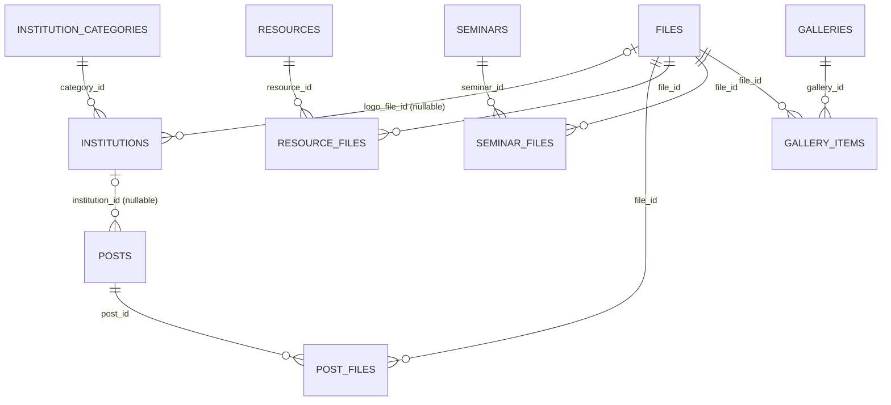

# KFCPA 홈페이지 DB 명세서 v2

> 문서 상태: v2 기준 명세  
> 구현 상태: 확장·데이터 이관 단계 구현 완료  
> 기준일: 2026-08-24  
> 적용 대상: KFCPA 홈페이지 콘텐츠 및 관리자 기능

## 1. 문서 목적과 적용 범위

이 문서는 KFCPA 홈페이지의 기관, 소식 게시물, 자료, 세미나, 파일 및 포토 갤러리를 관리하기 위한 **v2 데이터 모델**을 정의한다.

`20260824130000_expand_content_schema_v2.sql`에서 신규 구조 생성, 기존 데이터 이관, 제약조건, trigger, RLS 및 권한을 구현했다. 운영 데이터 검증 전 손실을 막기 위해 기존 `boards`, `organizations`, `seminar_events`와 `posts`·`post_files`의 호환 컬럼은 확장-축소 migration의 확장 단계로 유지한다. 신규 API 전환과 데이터 검증이 끝난 뒤 구 구조 제거를 별도 migration으로 수행한다.

물리 파일명은 기존 링크와 사용자 요청을 보존하기 위해 `KFCPA_DB_명세서_v1.md`를 유지한다. 다만 범용 게시물 구조를 도메인별 테이블과 중앙 파일 구조로 바꾸는 호환성 파괴 설계이므로 본문 버전은 v2로 표기한다.

이번 목표 구조에서 사용하는 애플리케이션 테이블은 정확히 다음 11개이다.

| 번호 | 테이블 | 역할 |
|---:|---|---|
| 1 | `files` | 이미지와 일반 첨부파일의 중앙 메타데이터 |
| 2 | `institution_categories` | 은행, 증권 등 기관 분류 기준정보 |
| 3 | `institutions` | 회원기관 및 협력기관 |
| 4 | `posts` | 공지사항, 협회소식, 회원기관 소식 |
| 5 | `post_files` | 소식 게시물과 이미지의 관계 |
| 6 | `resources` | 자료실 및 결산·공시 자료 |
| 7 | `resource_files` | 자료와 첨부파일의 관계 |
| 8 | `seminars` | 세미나 정보와 신청·일정 정보 |
| 9 | `seminar_files` | 세미나 포스터 및 행사 사진 관계 |
| 10 | `galleries` | 포토 갤러리 앨범 |
| 11 | `gallery_items` | 갤러리 앨범과 사진의 관계 |

Supabase Auth의 `auth.users`와 Storage의 내부 객체 정보는 Supabase가 관리하는 외부 스키마이다. 위 11개 애플리케이션 테이블 수에는 포함하지 않는다.

### 1.1 이번 명세에 포함하지 않는 항목

- 실제 migration SQL 작성 및 적용
- 기존 데이터 이전
- 생성된 TypeScript DB 타입 갱신
- 프론트엔드 쿼리와 관리자 화면 개편
- 일반 사용자 회원가입 및 로그인
- 관리자 세부 권한 등급
- 정적 소개 페이지 CMS
- 상담 및 신고 데이터

### 1.2 핵심 설계 원칙

1. 기관, 소식, 자료, 세미나는 서로 다른 수명주기와 필드를 가지므로 별도 테이블로 관리한다.
2. 실제 파일은 Supabase Storage에 저장하고 `files`에는 경로와 메타데이터만 저장한다.
3. 하나의 파일을 여러 콘텐츠에서 재사용할 수 있도록 파일 소유자를 `files`에 직접 저장하지 않는다.
4. 이미지 ID 배열이나 `target_type + target_id` 형태의 다형 참조를 사용하지 않는다.
5. 각 콘텐츠와 파일은 실제 FK를 가진 관계 테이블로 연결한다.
6. 포토 갤러리 노출 여부는 `files`의 boolean 값이 아니라 공개 앨범과의 관계로 결정한다.
7. 콘텐츠 삭제와 Storage 객체 삭제는 별개의 작업으로 취급한다.

---

## 2. 공통 규칙

### 2.1 식별자와 시간

- 모든 애플리케이션 테이블의 독립 식별자는 `uuid`를 사용한다.
- UUID 기본값은 `gen_random_uuid()`이다.
- 날짜와 시간이 함께 필요한 값은 `timestamptz`를 사용한다.
- 날짜만 필요한 행사 기준일은 `date`를 사용한다.
- 서버 시간은 UTC로 저장하고 화면에서 사용자 시간대로 변환한다.

### 2.2 생성·수정 메타데이터

독립적으로 수정되는 테이블은 다음 공통 컬럼을 사용한다.

| 컬럼 | 타입 | 규칙 |
|---|---|---|
| `created_by` 또는 `uploaded_by` | `uuid` | Nullable, `auth.users.id` FK, `ON DELETE SET NULL` |
| `created_at` | `timestamptz` | NOT NULL, 기본값 `now()` |
| `updated_at` | `timestamptz` | NOT NULL, 기본값 `now()`, 수정 trigger 적용 |

`updated_at`은 공통 `set_updated_at()` trigger 함수로 자동 갱신한다.

`created_by`와 `uploaded_by`는 클라이언트 입력을 신뢰하지 않는다. 각 독립 테이블의 `BEFORE INSERT` DB trigger가 값을 `auth.uid()`로 강제하고, 일반 `UPDATE`에서는 기존 값을 바꿀 수 없도록 DB trigger가 거부한다. 관리자 계정 삭제에 따른 FK의 `ON DELETE SET NULL` 동작만 허용되는 시스템 예외이다.

관계만 나타내는 `post_files`, `resource_files`, `seminar_files`, `gallery_items`에는 `created_at`만 둔다.

### 2.3 공개 상태

`posts`, `resources`, `seminars`, `galleries`는 같은 공개 상태값을 사용한다.

| 값 | 의미 |
|---|---|
| `draft` | 작성 중이며 공개하지 않음 |
| `published` | 공개 대상 |
| `hidden` | 기존 콘텐츠를 삭제하지 않고 숨김 |

공개 레코드는 다음 조건을 모두 만족해야 한다.

```text
status = 'published'
AND published_at IS NOT NULL
AND published_at <= now()
```

`published_at`이 미래인 `published` 레코드는 예약 공개 상태로 취급한다.

모든 콘텐츠 테이블에는 다음 CHECK를 둔다.

```text
status <> 'published' OR published_at IS NOT NULL
```

`hidden`으로 전환할 때 기존 `published_at`은 이력 보존을 위해 유지할 수 있다.

### 2.4 문자열 정규화

- 필수 이름과 제목은 저장 전에 앞뒤 공백을 제거한다.
- 공백만 있는 필수 문자열은 허용하지 않는다.
- URL은 `http://` 또는 `https://`만 허용한다.
- 파일 확장자는 파일 형식 판정의 단일 기준으로 사용하지 않는다. 브라우저의 MIME 선언값과 이미지 decode 결과를 함께 검증한다.
- HTML 본문은 저장 전 또는 출력 전에 허용 목록 기반으로 정제한다.

---

## 3. 전체 관계



중앙 파일의 재사용 예시는 다음과 같다.

```text
files의 사진 A
├─ seminar_files: 세미나 종료 사진
└─ gallery_items: 공개 포토 갤러리 사진

files의 사진 B
├─ post_files: 회원기관 소식 본문 사진
└─ gallery_items: 공개 포토 갤러리 사진
```

---

## 4. `files`

### 4.1 용도

Supabase Storage에 저장된 이미지와 일반 첨부파일의 중앙 메타데이터를 관리한다.

`files`는 파일이 어느 콘텐츠에서 사용되는지 직접 기록하지 않는다. 사용 위치는 각 관계 테이블과 `institutions.logo_file_id`를 통해 확인한다.

### 4.2 컬럼 명세

| 컬럼 | PostgreSQL 타입 | NULL | Key / Default | 설명 |
|---|---|---:|---|---|
| `id` | `uuid` | N | PK, `gen_random_uuid()` | 파일 고유 ID |
| `file_kind` | `text` | N | CHECK | 파일 분류 |
| `bucket_name` | `text` | N | 기본값 `public-assets` | Storage bucket 이름 |
| `storage_path` | `text` | N | - | bucket 내부 객체 경로 |
| `original_name` | `text` | N | - | 업로드 당시 원본 파일명 |
| `mime_type` | `text` | N | - | 업로드 시 확인한 MIME type |
| `size_bytes` | `bigint` | N | CHECK | 파일 크기(Byte) |
| `width_px` | `integer` | Y | NULL, CHECK | 이미지 가로 픽셀 |
| `height_px` | `integer` | Y | NULL, CHECK | 이미지 세로 픽셀 |
| `alt_text` | `text` | Y | NULL | 기본 이미지 대체 텍스트 |
| `uploaded_by` | `uuid` | Y | FK, `auth.uid()` | 업로드 관리자 |
| `created_at` | `timestamptz` | N | `now()` | 등록일시 |
| `updated_at` | `timestamptz` | N | `now()` | 메타데이터 수정일시 |

### 4.3 허용 값

`file_kind`:

| 값 | 의미 |
|---|---|
| `image` | 로고, 대표 이미지, 본문 이미지, 포스터, 행사 사진 |
| `attachment` | 문서, 압축파일 등 일반 첨부파일 |

### 4.4 제약조건

- `UNIQUE (bucket_name, storage_path)`
- `char_length(btrim(original_name)) BETWEEN 1 AND 255`
- `size_bytes > 0`
- `width_px IS NULL OR width_px > 0`
- `height_px IS NULL OR height_px > 0`
- `alt_text IS NULL OR char_length(alt_text) <= 500`
- `file_kind = 'image'`이면 `mime_type LIKE 'image/%'`
- `file_kind = 'image'`이면 `size_bytes <= 10485760`
- `file_kind = 'attachment'`이면 `size_bytes <= 52428800`
- `uploaded_by → auth.users.id ON DELETE SET NULL`

애플리케이션 업로드 한도는 이미지 10 MiB(10,485,760 Byte), 일반 첨부파일 50 MiB(52,428,800 Byte)이다. 실제 요청 한도는 **애플리케이션 한도와 해당 Storage bucket 한도 중 더 작은 값**을 적용한다. API의 사전 검증, DB CHECK 및 bucket 설정은 이 규칙과 일치해야 한다.

브라우저 직접 업로드에서 `mime_type`은 브라우저가 제공한 `File.type`과, 이미지인 경우 실제 이미지 decode 성공 여부까지 확인한 결과이다. 이는 파일의 magic byte를 서버에서 판독한 것과 동일한 보증은 아니다. 보안 정책상 magic-byte 검증이 필요하면 업로드를 Edge Function을 통과시켜 서버 측에서 검사한다.

파일이 등록된 뒤 `file_kind`, `bucket_name`, `storage_path`, `original_name`, `mime_type`, `size_bytes`, `width_px`, `height_px`, `uploaded_by`는 바이너리 정체성을 구성하는 불변 필드이다. `BEFORE UPDATE` DB trigger가 변경을 거부하며, 일반 수정은 `alt_text`만 허용한다.

### 4.5 인덱스

| 인덱스 | 컬럼 | 용도 |
|---|---|---|
| `files_bucket_path_uidx` | `bucket_name, storage_path` | Storage 객체의 중복 등록 방지 |
| `files_kind_created_idx` | `file_kind, created_at DESC, id DESC` | 관리자 파일 라이브러리 필터와 안정 정렬 |
| `files_uploaded_by_idx` | `uploaded_by` | 업로드 관리자 기준 조회 |

관리자 파일 목록은 같은 분류 안에서 `created_at DESC, id DESC`로 정렬한다.

### 4.6 삭제 정책

다른 레코드가 파일을 참조하는 동안 `files` 삭제를 허용하지 않는다.

- 모든 애플리케이션 FK: `ON DELETE RESTRICT`
- 참조가 0개인 파일만 삭제 가능
- DB 레코드 삭제와 Storage 객체 삭제는 파일 삭제 서비스가 함께 처리
- 부모 콘텐츠 삭제만으로 실제 파일을 자동 삭제하지 않음

---

## 5. `institution_categories`

### 5.1 용도

은행, 증권, 보험 등 기관의 업무 분류를 관리한다. 분류가 늘어날 수 있으므로 고정 enum이 아니라 기준정보 테이블을 사용한다.

### 5.2 컬럼 명세

| 컬럼 | PostgreSQL 타입 | NULL | Key / Default | 설명 |
|---|---|---:|---|---|
| `id` | `uuid` | N | PK, `gen_random_uuid()` | 기관 분류 ID |
| `code` | `text` | N | UNIQUE | 프로그램용 분류 코드 |
| `name` | `text` | N | UNIQUE | 화면 표시명 |
| `display_order` | `integer` | N | `0` | 노출 순서 |
| `is_active` | `boolean` | N | `true` | 사용 여부 |
| `created_by` | `uuid` | Y | FK, `auth.uid()` | 생성 관리자 |
| `created_at` | `timestamptz` | N | `now()` | 생성일시 |
| `updated_at` | `timestamptz` | N | `now()` | 수정일시 |

### 5.3 제약조건

- `char_length(code) BETWEEN 1 AND 50`
- `code ~ '^[a-z0-9_]+$'`
- `char_length(btrim(name)) BETWEEN 1 AND 100`
- `display_order >= 0`
- `created_by → auth.users.id ON DELETE SET NULL`
- 대소문자와 주변 공백만 다른 중복 이름을 막기 위해 `lower(btrim(name))` unique index 사용

분류 예시는 은행, 증권, 보험, 가상자산, 전자금융·컨설팅 등이다. 실제 초기 분류 코드는 migration 설계 시 운영 데이터와 함께 확정한다.

### 5.4 인덱스

- `institution_categories_code_uidx (code)`
- `institution_categories_name_normalized_uidx (lower(btrim(name)))`
- `institution_categories_public_order_idx (display_order, name, id) WHERE is_active = true`

공개 목록은 `display_order ASC, name ASC, id ASC`로 정렬한다.

### 5.5 삭제 정책

기관이 참조하는 분류는 삭제할 수 없다.

```text
institutions.category_id
→ institution_categories.id
ON DELETE RESTRICT
```

더 이상 사용하지 않는 분류는 `is_active = false`로 전환한다.

---

## 6. `institutions`

### 6.1 용도

회원기관과 협력기관의 기본 정보, 로고, 설명 및 홈페이지 링크를 관리한다.

### 6.2 컬럼 명세

| 컬럼 | PostgreSQL 타입 | NULL | Key / Default | 설명 |
|---|---|---:|---|---|
| `id` | `uuid` | N | PK, `gen_random_uuid()` | 기관 ID |
| `institution_type` | `text` | N | CHECK | 기관 타입 |
| `category_id` | `uuid` | N | FK | 기관 분류 ID |
| `name` | `text` | N | - | 기관명 |
| `logo_file_id` | `uuid` | Y | FK | 중앙 파일의 기관 로고 |
| `description` | `text` | N | `''` | 기관 설명 |
| `homepage_url` | `text` | Y | NULL, CHECK | 홈페이지 주소 |
| `display_order` | `integer` | N | `0` | 노출 순서 |
| `is_active` | `boolean` | N | `true` | 홈페이지 노출 및 사용 여부 |
| `created_by` | `uuid` | Y | FK, `auth.uid()` | 생성 관리자 |
| `created_at` | `timestamptz` | N | `now()` | 생성일시 |
| `updated_at` | `timestamptz` | N | `now()` | 수정일시 |

### 6.3 허용 값

`institution_type`:

| 값 | 의미 |
|---|---|
| `member` | 회원기관 |
| `partner` | 협력기관 |

### 6.4 FK와 제약조건

- `category_id → institution_categories.id ON DELETE RESTRICT`
- `logo_file_id → files.id ON DELETE RESTRICT`
- `created_by → auth.users.id ON DELETE SET NULL`
- `char_length(btrim(name)) BETWEEN 1 AND 200`
- `display_order >= 0`
- `homepage_url IS NULL OR (char_length(homepage_url) <= 2048 AND homepage_url ~* '^https?://')`
- `lower(btrim(name))` unique index로 이름 중복 방지
- `logo_file_id`가 가리키는 파일은 `file_kind = 'image'`여야 함

마지막 조건은 일반 FK나 CHECK만으로 다른 테이블의 값을 검사할 수 없으므로 `institutions`의 INSERT 및 `logo_file_id` UPDATE에 적용하는 DB trigger가 반드시 검증한다. 관리용 RPC를 사용하더라도 이 trigger를 우회하지 않는다.

### 6.5 인덱스

- `institutions_name_normalized_uidx (lower(btrim(name)))`
- `institutions_public_list_idx (institution_type, category_id, display_order, name, id) WHERE is_active = true`
- `institutions_category_idx (category_id)`
- `institutions_logo_file_idx (logo_file_id)`

기관 목록은 `display_order ASC, name ASC, id ASC`를 안정 정렬로 사용한다.

### 6.6 삭제 정책

기관은 일반적으로 물리 삭제하지 않고 `is_active = false`로 비활성화한다.

`posts.institution_id`가 참조하는 기관의 삭제는 `ON DELETE RESTRICT`로 막는다. 회원기관 소식의 활동 주체 이력을 보존하기 위해 기관 삭제 시 FK를 NULL로 바꾸지 않는다.

---

## 7. `posts`

### 7.1 용도

다음 세 가지 성격이 유사한 소식 게시물을 하나의 테이블에서 관리한다.

- 공지사항
- 협회소식
- 회원기관 소식

`posts`는 자료, 세미나 또는 포토 갤러리를 저장하지 않는다.

### 7.2 컬럼 명세

| 컬럼 | PostgreSQL 타입 | NULL | Key / Default | 설명 |
|---|---|---:|---|---|
| `id` | `uuid` | N | PK, `gen_random_uuid()` | 게시물 ID |
| `category` | `text` | N | CHECK | 게시물 카테고리 |
| `title` | `text` | N | - | 제목 |
| `content` | `text` | N | `''` | 상세 본문 |
| `institution_id` | `uuid` | Y | FK | 회원기관 소식의 활동 주체 |
| `status` | `text` | N | `draft` | 공개 상태 |
| `is_pinned` | `boolean` | N | `false` | 목록 상단 고정 여부 |
| `published_at` | `timestamptz` | Y | NULL | 게시일 및 예약 공개 시각 |
| `created_by` | `uuid` | Y | FK, `auth.uid()` | 작성 관리자 |
| `created_at` | `timestamptz` | N | `now()` | 시스템 등록일시 |
| `updated_at` | `timestamptz` | N | `now()` | 수정일시 |

사용자가 보는 등록일은 `published_at`이다. `created_at`은 실제 DB 레코드가 만들어진 시스템 시각으로 구분한다.

### 7.3 허용 값

`category`:

| 값 | 의미 |
|---|---|
| `notice` | 공지사항 |
| `association_news` | 협회소식 |
| `member_news` | 회원기관 소식 |

`status`: `draft | published | hidden`

### 7.4 제약조건

- `char_length(btrim(title)) BETWEEN 1 AND 200`
- `institution_id → institutions.id ON DELETE RESTRICT`
- `created_by → auth.users.id ON DELETE SET NULL`
- `status <> 'published' OR published_at IS NOT NULL`
- 회원기관 소식은 `institution_id`가 필수이고 다른 카테고리는 NULL이어야 함

```text
(
  category = 'member_news'
  AND institution_id IS NOT NULL
)
OR
(
  category <> 'member_news'
  AND institution_id IS NULL
)
```

추가로 회원기관 소식이 참조하는 기관은 `institutions.institution_type = 'member'`여야 한다. `posts`의 INSERT 및 `category`, `institution_id` UPDATE에 적용하는 DB trigger가 이 규칙을 반드시 검증한다. 반대로 회원기관 소식이 참조 중인 기관의 `institution_type`을 `partner`로 바꾸는 것도 `institutions`의 DB trigger가 거부한다.

### 7.5 이미지 연결

이미지 ID 배열을 `posts`에 저장하지 않는다.

- 여러 이미지는 `post_files`의 여러 행으로 표현
- 대표 이미지는 `post_files.role = 'cover'`
- 나머지 본문 이미지는 `post_files.role = 'content'`
- 같은 중앙 이미지를 포토 갤러리에서도 재사용 가능

본문 HTML이 Storage URL을 직접 소유하지 않도록, 에디터는 가능한 경우 파일 ID 기반 참조를 생성하고 응답 변환 단계에서 URL을 해석한다.

### 7.6 인덱스와 정렬

- `posts_public_list_idx (category, is_pinned DESC, published_at DESC, created_at DESC, id DESC) WHERE status = 'published'`
- `posts_institution_published_idx (institution_id, published_at DESC, id DESC)`
- `posts_created_by_idx (created_by)`

기본 공개 목록 정렬:

```text
1. is_pinned DESC
2. published_at DESC
3. created_at DESC
4. id DESC
```

`is_pinned`은 `posts`에만 존재한다.

---

## 8. `post_files`

### 8.1 용도

`posts`와 `files`의 다대다 관계, 이미지 용도 및 노출 순서를 관리한다.

### 8.2 컬럼 명세

| 컬럼 | PostgreSQL 타입 | NULL | Key / Default | 설명 |
|---|---|---:|---|---|
| `post_id` | `uuid` | N | PK, FK | 게시물 ID |
| `file_id` | `uuid` | N | PK, FK | 중앙 파일 ID |
| `role` | `text` | N | CHECK | 게시물 내 이미지 용도 |
| `sort_order` | `integer` | N | `0` | 이미지 순서 |
| `created_at` | `timestamptz` | N | `now()` | 연결일시 |

복합 PK는 `(post_id, file_id)`이다.

### 8.3 허용 값

`role`:

| 값 | 의미 |
|---|---|
| `cover` | 목록 및 상세의 대표 이미지 |
| `content` | 본문 또는 상세 갤러리 이미지 |

### 8.4 FK와 제약조건

- `post_id → posts.id ON DELETE CASCADE`
- `file_id → files.id ON DELETE RESTRICT`
- `sort_order >= 0`
- 연결 파일은 `files.file_kind = 'image'`여야 함
- 게시물당 `cover`는 최대 1개

대표 이미지 제약은 다음 partial unique index로 보장한다.

```text
UNIQUE (post_id) WHERE role = 'cover'
```

### 8.5 인덱스

- PK `(post_id, file_id)`
- `post_files_post_order_idx (post_id, role, sort_order, created_at, file_id)`
- `post_files_file_idx (file_id)`
- `post_files_one_cover_uidx (post_id) WHERE role = 'cover'`

역할별 이미지 목록은 `sort_order ASC, created_at ASC, file_id ASC`로 정렬한다.

---

## 9. `resources`

### 9.1 용도

자료실과 결산·공시 자료의 제목, 게시일 및 공개 상태를 관리한다.

파일은 `resource_files`를 통해 연결하며 파일 형식은 제한하지 않는다.

### 9.2 컬럼 명세

| 컬럼 | PostgreSQL 타입 | NULL | Key / Default | 설명 |
|---|---|---:|---|---|
| `id` | `uuid` | N | PK, `gen_random_uuid()` | 자료 ID |
| `category` | `text` | N | CHECK | 자료 카테고리 |
| `title` | `text` | N | - | 자료 제목 |
| `reference_year` | `smallint` | Y | NULL, CHECK | 결산·공시 기준연도 |
| `status` | `text` | N | `draft` | 공개 상태 |
| `published_at` | `timestamptz` | Y | NULL | 게시일 및 예약 공개 시각 |
| `created_by` | `uuid` | Y | FK, `auth.uid()` | 작성 관리자 |
| `created_at` | `timestamptz` | N | `now()` | 시스템 등록일시 |
| `updated_at` | `timestamptz` | N | `now()` | 수정일시 |

### 9.3 허용 값

`category`:

| 값 | 의미 |
|---|---|
| `resource` | 일반 자료실 |
| `financial_disclosure` | 결산·공시 자료 |

`status`: `draft | published | hidden`

### 9.4 제약조건

- `char_length(btrim(title)) BETWEEN 1 AND 200`
- `reference_year IS NULL OR reference_year BETWEEN 1900 AND 2100`
- `status <> 'published' OR published_at IS NOT NULL`
- `created_by → auth.users.id ON DELETE SET NULL`

`reference_year`는 결산·공시 연도별 조회를 위한 선택값이다. 일반 자료에서도 연도 분류가 필요하면 사용할 수 있으므로 카테고리에 따른 필수값으로 제한하지 않는다.

### 9.5 게시 전 파일 검증

`status = 'published'`로 전환할 때 연결된 `resource_files`가 최소 1개 있어야 한다.

이 규칙은 한 행의 CHECK만으로 관계 테이블을 조회할 수 없으므로 `resources`의 INSERT 및 모든 UPDATE에 적용하는 **지연 가능한 DB constraint trigger**가 `NEW.status = 'published'`일 때 transaction 종료 시 반드시 검증한다. 이를 통해 같은 transaction에서 부모와 파일 관계를 순서대로 만들 수 있다. `draft` 상태에서는 파일이 없어도 된다.

공개 자료에서 마지막 `resource_files` 관계를 직접 삭제하는 것도 관계 테이블의 지연 constraint trigger가 거부한다. 다만 부모 `resources` 자체를 삭제해 FK CASCADE가 실행되는 경우에는 부모 행이 이미 없으므로 관계 삭제를 허용한다. 관리용 RPC는 이 불변식을 대체하지 않고 원자 작업을 편리하게 제공할 뿐이다.

### 9.6 인덱스와 정렬

- `resources_public_list_idx (category, published_at DESC, created_at DESC, id DESC) WHERE status = 'published'`
- `resources_category_year_idx (category, reference_year DESC, published_at DESC, id DESC)`
- `resources_created_by_idx (created_by)`

기본 공개 목록은 `published_at DESC, created_at DESC, id DESC`로 정렬한다.

---

## 10. `resource_files`

### 10.1 용도

`resources`와 `files`를 연결하고 한 자료에 첨부된 여러 파일의 순서를 관리한다.

### 10.2 컬럼 명세

| 컬럼 | PostgreSQL 타입 | NULL | Key / Default | 설명 |
|---|---|---:|---|---|
| `resource_id` | `uuid` | N | PK, FK | 자료 ID |
| `file_id` | `uuid` | N | PK, FK | 중앙 파일 ID |
| `sort_order` | `integer` | N | `0` | 첨부파일 노출 순서 |
| `created_at` | `timestamptz` | N | `now()` | 연결일시 |

복합 PK는 `(resource_id, file_id)`이다.

### 10.3 FK와 제약조건

- `resource_id → resources.id ON DELETE CASCADE`
- `file_id → files.id ON DELETE RESTRICT`
- `sort_order >= 0`
- 파일 확장자와 MIME type 종류에는 DB CHECK 제한을 두지 않음

빈 파일은 `files.size_bytes > 0`에서 차단한다. 확장자 종류는 제한하지 않지만 MIME 선언값을 기록하며, 최대 크기는 `image` 10 MiB 또는 `attachment` 50 MiB와 bucket 한도 중 더 작은 값을 적용한다.

### 10.4 인덱스

- PK `(resource_id, file_id)`
- `resource_files_resource_order_idx (resource_id, sort_order, created_at, file_id)`
- `resource_files_file_idx (file_id)`

첨부파일 목록은 `sort_order ASC, created_at ASC, file_id ASC`로 정렬한다.

---

## 11. `seminars`

### 11.1 용도

예정 행사와 지난 행사를 하나의 세미나 데이터로 관리한다.

- 예정 행사에서는 `introduction`을 주요 소개문으로 사용
- 포스터와 종료 후 사진은 `seminar_files`에서 관리

### 11.2 컬럼 명세

| 컬럼 | PostgreSQL 타입 | NULL | Key / Default | 설명 |
|---|---|---:|---|---|
| `id` | `uuid` | N | PK, `gen_random_uuid()` | 세미나 ID |
| `title` | `text` | N | - | 세미나명 |
| `introduction` | `text` | N | `''` | 예정 행사 소개 |
| `content` | `text` | Y | NULL | 선택 상세 본문 |
| `starts_at` | `timestamptz` | N | - | 시작 일시 |
| `ends_at` | `timestamptz` | Y | NULL | 종료 일시 |
| `location` | `text` | N | - | 장소 |
| `selection_method` | `text` | N | CHECK | 선발 방식 |
| `selection_method_detail` | `text` | Y | NULL | 기타 방식 또는 보충 설명 |
| `capacity` | `integer` | Y | NULL, CHECK | 모집 인원 |
| `registration_deadline` | `timestamptz` | Y | NULL | 접수 마감일시 |
| `application_url` | `text` | Y | NULL, CHECK | 외부 신청 링크 |
| `status` | `text` | N | `draft` | 공개 상태 |
| `published_at` | `timestamptz` | Y | NULL | 게시일 및 예약 공개 시각 |
| `created_by` | `uuid` | Y | FK, `auth.uid()` | 작성 관리자 |
| `created_at` | `timestamptz` | N | `now()` | 생성일시 |
| `updated_at` | `timestamptz` | N | `now()` | 수정일시 |

### 11.3 허용 값

`selection_method`:

| 값 | 의미 |
|---|---|
| `first_come` | 선착순 |
| `lottery` | 추첨 |
| `other` | 기타 |

`status`: `draft | published | hidden`

### 11.4 제약조건

- `char_length(btrim(title)) BETWEEN 1 AND 200`
- `char_length(btrim(location)) BETWEEN 1 AND 300`
- `ends_at IS NULL OR ends_at >= starts_at`
- `registration_deadline IS NULL OR registration_deadline <= starts_at`
- `capacity IS NULL OR capacity > 0`
- `application_url IS NULL OR (char_length(application_url) <= 2048 AND application_url ~* '^https?://')`
- `selection_method <> 'other' OR (selection_method_detail IS NOT NULL AND char_length(btrim(selection_method_detail)) > 0)`
- `status <> 'published' OR published_at IS NOT NULL`
- `created_by → auth.users.id ON DELETE SET NULL`

### 11.5 행사 단계 계산

공개 상태와 행사 진행 단계는 다른 개념이므로 `upcoming`, `past` 같은 상태를 별도 컬럼에 중복 저장하지 않는다.

조회 시 다음과 같이 계산한다.

```text
예정·진행 중 행사:
coalesce(ends_at, starts_at) >= now()

지난 행사:
coalesce(ends_at, starts_at) < now()
```

`ends_at`이 있는 행사의 진행 중 여부는 `starts_at <= now() AND ends_at >= now()`로 판단할 수 있다.

### 11.6 인덱스와 정렬

- `seminars_public_starts_idx (starts_at ASC, id ASC) WHERE status = 'published'`
- `seminars_public_ends_idx (coalesce(ends_at, starts_at) DESC, starts_at DESC, id DESC) WHERE status = 'published'`
- `seminars_registration_deadline_idx (registration_deadline) WHERE registration_deadline IS NOT NULL`
- `seminars_created_by_idx (created_by)`

예정·진행 중 행사는 `starts_at ASC, id ASC`, 지난 행사는 `coalesce(ends_at, starts_at) DESC, starts_at DESC, id DESC`로 정렬한다.

---

## 12. `seminar_files`

### 12.1 용도

세미나 포스터와 종료 후 행사 사진을 중앙 파일에 연결한다.

### 12.2 컬럼 명세

| 컬럼 | PostgreSQL 타입 | NULL | Key / Default | 설명 |
|---|---|---:|---|---|
| `seminar_id` | `uuid` | N | PK, FK | 세미나 ID |
| `file_id` | `uuid` | N | PK, FK | 중앙 파일 ID |
| `role` | `text` | N | CHECK | 세미나 내 이미지 용도 |
| `sort_order` | `integer` | N | `0` | 사진 노출 순서 |
| `created_at` | `timestamptz` | N | `now()` | 연결일시 |

복합 PK는 `(seminar_id, file_id)`이다.

### 12.3 허용 값

`role`:

| 값 | 의미 |
|---|---|
| `poster` | 세미나 대표 포스터 |
| `photo` | 종료 후 행사 사진 |

### 12.4 FK와 제약조건

- `seminar_id → seminars.id ON DELETE CASCADE`
- `file_id → files.id ON DELETE RESTRICT`
- `sort_order >= 0`
- 연결 파일은 `files.file_kind = 'image'`여야 함
- 세미나당 `poster`는 최대 1개

포스터 제약은 다음 partial unique index로 보장한다.

```text
UNIQUE (seminar_id) WHERE role = 'poster'
```

### 12.5 인덱스

- PK `(seminar_id, file_id)`
- `seminar_files_seminar_order_idx (seminar_id, role, sort_order, created_at, file_id)`
- `seminar_files_file_idx (file_id)`
- `seminar_files_one_poster_uidx (seminar_id) WHERE role = 'poster'`

역할별 세미나 이미지 목록은 `sort_order ASC, created_at ASC, file_id ASC`로 정렬한다.

세미나 사진을 포토 갤러리에 공개하려면 같은 `file_id`를 `gallery_items`에도 연결한다. 파일을 다시 업로드하지 않는다.

---

## 13. `galleries`

### 13.1 용도

포토 갤러리에 공개할 사진을 앨범 단위로 묶어 관리한다.

파일 자체의 속성과 공개 앨범의 제목·설명·행사일·공개 상태를 분리한다.

### 13.2 컬럼 명세

| 컬럼 | PostgreSQL 타입 | NULL | Key / Default | 설명 |
|---|---|---:|---|---|
| `id` | `uuid` | N | PK, `gen_random_uuid()` | 갤러리 앨범 ID |
| `title` | `text` | N | - | 앨범 제목 |
| `description` | `text` | N | `''` | 앨범 설명 |
| `event_date` | `date` | Y | NULL | 촬영 행사 기준일 |
| `status` | `text` | N | `draft` | 공개 상태 |
| `published_at` | `timestamptz` | Y | NULL | 게시일 및 예약 공개 시각 |
| `display_order` | `integer` | N | `0` | 동일 기준일 내 우선순위 |
| `created_by` | `uuid` | Y | FK, `auth.uid()` | 생성 관리자 |
| `created_at` | `timestamptz` | N | `now()` | 생성일시 |
| `updated_at` | `timestamptz` | N | `now()` | 수정일시 |

### 13.3 제약조건

- `char_length(btrim(title)) BETWEEN 1 AND 200`
- `display_order >= 0`
- `status <> 'published' OR published_at IS NOT NULL`
- `created_by → auth.users.id ON DELETE SET NULL`

### 13.4 게시 전 사진 검증

`status = 'published'`로 전환할 때 `gallery_items`가 최소 1개 있어야 한다.

이 규칙은 `galleries`의 INSERT 및 모든 UPDATE에 적용하는 **지연 가능한 DB constraint trigger**가 `NEW.status = 'published'`일 때 transaction 종료 시 반드시 검증한다. 이를 통해 같은 transaction에서 앨범과 사진 관계를 순서대로 만들 수 있다. 빈 앨범은 `draft` 상태로 저장할 수 있다.

공개 갤러리의 마지막 `gallery_items` 관계를 직접 삭제하는 것도 관계 테이블의 지연 constraint trigger가 거부한다. 다만 부모 `galleries` 자체를 삭제해 FK CASCADE가 실행되는 경우에는 부모 행이 이미 없으므로 관계 삭제를 허용한다. 관리용 RPC는 이 불변식을 대체하지 않고 원자 작업을 편리하게 제공할 뿐이다.

### 13.5 인덱스와 정렬

- `galleries_public_list_idx (event_date DESC, display_order, published_at DESC, id DESC) WHERE status = 'published'`
- `galleries_created_by_idx (created_by)`

`event_date`가 NULL인 경우 공개 목록의 뒤쪽에 배치하고 `published_at DESC, id DESC`를 보조 정렬로 사용한다.

---

## 14. `gallery_items`

### 14.1 용도

갤러리 앨범과 중앙 이미지의 관계, 사진별 캡션 및 순서를 관리한다.

### 14.2 컬럼 명세

| 컬럼 | PostgreSQL 타입 | NULL | Key / Default | 설명 |
|---|---|---:|---|---|
| `gallery_id` | `uuid` | N | PK, FK | 갤러리 앨범 ID |
| `file_id` | `uuid` | N | PK, FK | 중앙 이미지 ID |
| `caption` | `text` | N | `''` | 해당 앨범에서 사용할 사진 설명 |
| `sort_order` | `integer` | N | `0` | 앨범 내 사진 순서 |
| `created_at` | `timestamptz` | N | `now()` | 연결일시 |

복합 PK는 `(gallery_id, file_id)`이다.

### 14.3 FK와 제약조건

- `gallery_id → galleries.id ON DELETE CASCADE`
- `file_id → files.id ON DELETE RESTRICT`
- `char_length(caption) <= 500`
- `sort_order >= 0`
- 연결 파일은 `files.file_kind = 'image'`여야 함

`file_id`에 전역 UNIQUE를 두지 않는다. 같은 중앙 사진을 여러 앨범에서 재사용할 수 있다. 동일 앨범 안의 중복은 복합 PK가 차단한다.

### 14.4 인덱스

- PK `(gallery_id, file_id)`
- `gallery_items_gallery_order_idx (gallery_id, sort_order, created_at, file_id)`
- `gallery_items_file_idx (file_id)`

앨범 사진은 `sort_order ASC, created_at ASC, file_id ASC`로 정렬한다.

### 14.5 포토 갤러리 노출 판정

사진은 다음 조건일 때 포토 갤러리에 노출된다.

```text
gallery_items에 연결되어 있음
AND 연결된 galleries.status = 'published'
AND galleries.published_at <= now()
```

따라서 `files`에는 `is_gallery_visible` 같은 boolean 컬럼을 두지 않는다.

---

## 15. 교차 테이블 무결성

일반 CHECK는 다른 테이블의 값을 조회할 수 없으므로 다음 규칙은 **DB trigger로 반드시 강제**한다. 관리용 RPC는 여러 행과 Storage 작업을 원자적으로 조율하기 위한 편의 계층이며 무결성 경계가 아니다. `authenticated`가 테이블을 직접 INSERT, UPDATE 또는 DELETE하더라도 같은 trigger가 실행되어야 한다.

### 15.1 이미지 용도 검증

다음 참조는 반드시 `files.file_kind = 'image'`를 가리켜야 한다.

- `institutions.logo_file_id`
- `post_files.file_id`
- `seminar_files.file_id`
- `gallery_items.file_id`

`resource_files.file_id`는 이미지와 일반 첨부파일을 모두 허용한다.

각 참조를 생성하거나 파일 ID를 변경하는 INSERT·UPDATE에 `BEFORE` trigger를 적용한다. `files.file_kind` 자체는 등록 후 변경할 수 없으므로 연결 뒤 이미지가 일반 첨부파일로 바뀌는 우회도 차단한다.

### 15.2 회원기관 소식 검증

`posts.category = 'member_news'`이면:

- `institution_id`가 NULL이 아니어야 함
- 참조 기관의 `institution_type`이 `member`여야 함

공지사항과 협회소식의 `institution_id`는 NULL이어야 한다.

다음 양방향 trigger를 모두 둔다.

- `posts` INSERT 및 `category`, `institution_id` UPDATE: 위 카테고리·기관 규칙 검증
- `institutions.institution_type` UPDATE: 해당 기관을 참조하는 `member_news`가 하나라도 있으면 `member → partner` 변경 거부

이 역방향 검증으로 이미 공개된 회원기관 소식이 기관 타입 변경 때문에 잘못된 상태가 되는 것을 막는다.

### 15.3 작성자·업로더 강제

다음 actor 필드는 클라이언트가 정하지 않는다.

- `files.uploaded_by`
- `institution_categories.created_by`
- `institutions.created_by`
- `posts.created_by`
- `resources.created_by`
- `seminars.created_by`
- `galleries.created_by`

각 테이블의 `BEFORE INSERT` trigger는 전달된 값을 무시하고 `auth.uid()`를 저장한다. `BEFORE UPDATE` trigger는 actor 값 변경을 거부한다. 계정 삭제에 따른 FK의 `ON DELETE SET NULL`만 시스템 예외로 허용하며, 일반 API는 actor 필드를 입력 또는 수정 DTO에 포함하지 않는다.

### 15.4 파일 바이너리 메타데이터 불변

`files`가 생성된 뒤 다음 값은 변경할 수 없다.

- `file_kind`
- `bucket_name`
- `storage_path`
- `original_name`
- `mime_type`
- `size_bytes`
- `width_px`
- `height_px`
- `uploaded_by`

`files`의 `BEFORE UPDATE` trigger는 위 값 중 하나라도 달라지면 거부한다. 파일 교체는 기존 파일 행 수정이 아니라 새 Storage 객체와 새 `files.id` 생성으로 처리한다. 일반적으로 수정 가능한 파일 메타데이터는 `alt_text`뿐이다.

### 15.5 공개 자료·갤러리의 최소 관계

- 공개 자료에는 `resource_files`가 최소 1개 있어야 함
- 공개 갤러리에는 `gallery_items`가 최소 1개 있어야 함

다음 지연 가능한 DB constraint trigger를 transaction 종료 시 실행한다.

- `resources`의 published INSERT·UPDATE: 연결된 `resource_files`가 1개 이상인지 검증
- `galleries`의 published INSERT·UPDATE: 연결된 `gallery_items`가 1개 이상인지 검증
- `resource_files` DELETE 또는 부모 변경 UPDATE: 기존 부모가 여전히 존재하고 published이면 마지막 관계 제거 거부
- `gallery_items` DELETE 또는 부모 변경 UPDATE: 기존 부모가 여전히 존재하고 published이면 마지막 관계 제거 거부

부모 `resources` 또는 `galleries` 자체를 삭제해 FK CASCADE가 실행되는 경우에는 검사 시 부모 행이 존재하지 않으므로 관계 삭제를 허용한다. RPC를 거치지 않은 직접 CRUD에도 같은 규칙이 적용된다.

### 15.6 단일 대표 이미지

- 세미나 포스터는 선택값이지만 등록되는 경우 최대 1개
- 소식 대표 이미지는 선택값이지만 등록되는 경우 최대 1개

이 두 규칙은 각각 `role = 'poster'`, `role = 'cover'`인 partial unique index로 강제한다.

### 15.7 정렬 순서

`sort_order`와 `display_order`는 0 이상의 정수이다.

같은 순서값은 허용한다. 순서 변경 과정에서 임시 충돌이 발생하지 않도록 순서 컬럼에는 일반 UNIQUE를 두지 않는다.

모든 목록은 안정적인 최종 tie-breaker를 명시한다.

- 독립 레코드 목록: 마지막에 `id ASC` 또는 `id DESC`
- 파일 관계 목록: 마지막에 `file_id ASC`
- 이름 기반 목록: `display_order`, 이름, `id ASC`

페이지네이션의 이전·다음 요청은 같은 정렬 방향과 동일한 `id` 또는 `file_id` tie-breaker를 사용해야 한다.

---

## 16. 인덱스 설계 요약

| 조회 목적 | 핵심 인덱스 |
|---|---|
| 기관 타입·분류별 공개 목록 | `institutions(institution_type, category_id, display_order, name, id)` partial |
| 카테고리별 소식 목록 | `posts(category, is_pinned DESC, published_at DESC, created_at DESC, id DESC)` partial |
| 기관별 회원기관 소식 | `posts(institution_id, published_at DESC, id DESC)` |
| 카테고리·연도별 자료 | `resources(category, reference_year DESC, published_at DESC, id DESC)` |
| 예정·지난 세미나 | `seminars(starts_at, id)`, `seminars(coalesce(ends_at, starts_at), starts_at, id)` partial |
| 갤러리 연도·행사일 목록 | `galleries(event_date DESC, display_order, published_at DESC, id DESC)` partial |
| 관계별 파일 정렬 | 각 관계 테이블의 `(parent_id, role?, sort_order, created_at, file_id)` |
| 파일 역참조 | 각 관계 테이블의 `file_id` |
| Storage 객체 식별 | `files(bucket_name, storage_path)` unique |

partial 공개 인덱스의 조건은 `status = 'published'`이다. 예약 공개의 `published_at <= now()`는 시간 변화 때문에 인덱스 predicate에 직접 넣지 않고 쿼리 조건으로 적용한다.

---

## 17. RLS와 권한

본 프로젝트는 브라우저에서 Supabase에 직접 접근하는 구조이므로 모든 11개 테이블에 Row Level Security를 활성화한다.

### 17.1 역할 정의

| 역할 | 의미 |
|---|---|
| `anon` | 로그인하지 않은 홈페이지 방문자 |
| `authenticated` | 현재 구조의 관리자 계정 |

현재는 일반 사용자 로그인이 없다는 전제에서 `authenticated` 전원을 관리자로 취급한다. 향후 일반 로그인 기능이 생기면 관리자 claim 또는 별도 권한 모델을 먼저 도입한 뒤 정책을 분리해야 한다.

### 17.2 권한 매트릭스

| 테이블 | anon SELECT | anon 쓰기 | authenticated |
|---|---|---|---|
| `files` | 공개 콘텐츠에서 참조되는 행의 공개 컬럼만 | 금지 | CRUD, trigger 적용 |
| `institution_categories` | `is_active = true` | 금지 | CRUD |
| `institutions` | 기관과 분류가 모두 active인 행 | 금지 | CRUD, trigger 적용 |
| `posts` | 공개 조건과 기관 조건을 충족하는 행 | 금지 | CRUD, trigger 적용 |
| `post_files` | 공개 게시물 관계만 | 금지 | CRUD |
| `resources` | 공개 조건 충족 행 | 금지 | CRUD |
| `resource_files` | 공개 자료 관계만 | 금지 | CRUD |
| `seminars` | 공개 조건 충족 행 | 금지 | CRUD |
| `seminar_files` | 공개 세미나 관계만 | 금지 | CRUD |
| `galleries` | 공개 조건 충족 행 | 금지 | CRUD |
| `gallery_items` | 공개 갤러리 관계만 | 금지 | CRUD |

### 17.3 공개 행 조건

`posts`, `resources`, `seminars`, `galleries`:

```text
status = 'published'
AND published_at IS NOT NULL
AND published_at <= now()
```

`post_files`, `resource_files`, `seminar_files`, `gallery_items`는 각각 부모가 위 공개 조건을 만족하는 경우에만 `anon SELECT`를 허용한다.

`institutions`의 공개 조건은 기관 자체와 연결된 분류가 모두 활성인 것이다.

```text
institutions.is_active = true
AND EXISTS (
  연결된 institution_categories.is_active = true
)
```

`posts.category = 'member_news'`인 공개 소식은 공통 게시물 공개 조건에 더해 다음 조건을 모두 만족해야 한다.

```text
연결된 institutions.institution_type = 'member'
AND institutions.is_active = true
AND 연결된 institution_categories.is_active = true
```

공지사항과 협회소식은 기관 참조가 없으므로 공통 게시물 공개 조건만 사용한다.

`files`의 공개 SELECT는 다음 중 하나를 만족하는 참조가 존재할 때만 허용한다.

- 기관과 연결 분류가 모두 active인 기관의 로고
- 공개 소식의 `post_files`
- 공개 자료의 `resource_files`
- 공개 세미나의 `seminar_files`
- 공개 갤러리의 `gallery_items`

### 17.4 관리자 정책

현재 전제에서는 모든 테이블에 다음 관리 정책을 적용한다.

```text
FOR ALL
TO authenticated
USING (true)
WITH CHECK (true)
```

RLS는 행 접근만 제어한다. `authenticated`의 직접 CRUD에도 15절의 모든 DB trigger가 실행되어 이미지 타입, 기관 주체, actor 불변, 파일 메타데이터 불변 및 공개 전 최소 관계를 강제한다.

### 17.5 기본 권한

- 모든 11개 테이블에서 `anon`, `authenticated`의 기본 권한을 먼저 회수
- `anon`에는 테이블 전체 SELECT를 부여하지 않고 공개할 컬럼만 column-level SELECT로 부여
- `authenticated`에는 SELECT, INSERT, UPDATE, DELETE를 부여하되 DB trigger를 우회할 수 없음
- 관리용 RPC의 실행 권한은 `authenticated`에만 부여
- `anon`에는 관리용 RPC 실행 권한을 부여하지 않음

`anon` column grant에서는 actor 필드를 제외한다.

| 테이블 | anon에 허용하는 컬럼 |
|---|---|
| `files` | `id`, `file_kind`, `bucket_name`, `storage_path`, `original_name`, `mime_type`, `size_bytes`, `width_px`, `height_px`, `alt_text`, `created_at`, `updated_at` |
| `institution_categories` | `id`, `code`, `name`, `display_order`, `is_active`, `created_at`, `updated_at` |
| `institutions` | `id`, `institution_type`, `category_id`, `name`, `logo_file_id`, `description`, `homepage_url`, `display_order`, `is_active`, `created_at`, `updated_at` |
| `posts` | `id`, `category`, `title`, `content`, `institution_id`, `status`, `is_pinned`, `published_at`, `created_at`, `updated_at` |
| `resources` | `id`, `category`, `title`, `reference_year`, `status`, `published_at`, `created_at`, `updated_at` |
| `seminars` | `id`, `title`, `introduction`, `content`, `starts_at`, `ends_at`, `location`, `selection_method`, `selection_method_detail`, `capacity`, `registration_deadline`, `application_url`, `status`, `published_at`, `created_at`, `updated_at` |
| `galleries` | `id`, `title`, `description`, `event_date`, `status`, `published_at`, `display_order`, `created_at`, `updated_at` |

`post_files`, `resource_files`, `seminar_files`, `gallery_items`에는 actor 컬럼이 없으므로 해당 관계 테이블의 전체 컬럼을 column-level SELECT로 허용하되, 공개 부모를 확인하는 RLS는 그대로 적용한다.

따라서 `anon`은 `files.uploaded_by`와 각 독립 콘텐츠의 `created_by`를 조회할 수 없다. 공개 API는 `select('*')` 대신 위 허용 컬럼을 명시적으로 선택한다.

---

## 18. Supabase Storage

### 18.1 저장 원칙

실제 바이너리는 Supabase Storage에 저장하고 DB에는 다음 정보만 저장한다.

- bucket 이름
- Storage 내부 경로
- 원본 파일명
- MIME type
- 크기
- 이미지 크기와 대체 텍스트

DB에는 공개 URL 전체를 저장하지 않는다. URL은 `bucket_name`과 `storage_path`를 사용해 실행 시 생성한다.

브라우저 직접 업로드의 MIME 검증 수준은 브라우저가 선언한 `File.type` 확인과 이미지 decode 성공 여부이다. 확장자만으로 허용 여부를 정하지 않지만, 이 검증만으로 파일의 magic byte까지 신뢰할 수 있는 것은 아니다. magic-byte 검증이 보안 요구사항이면 공개 클라이언트가 Storage에 직접 쓰지 않고 Edge Function이 파일 내용을 검사한 뒤 업로드해야 한다.

### 18.2 기본 bucket

```text
public-assets
```

`files.bucket_name`의 기본값도 `public-assets`이다.

애플리케이션 한도는 다음과 같다.

| 파일 분류 | 애플리케이션 한도 |
|---|---:|
| `image` | 10 MiB / 10,485,760 Byte |
| `attachment` | 50 MiB / 52,428,800 Byte |

실제 허용 크기는 `min(애플리케이션 한도, bucket 한도)`이다. 예를 들어 bucket 한도가 8 MiB이면 이미지와 일반 첨부파일 모두 8 MiB까지만 허용한다.

### 18.3 권장 경로

파일은 여러 콘텐츠에서 재사용되므로 특정 게시물 ID에 경로를 종속하지 않는다.

```text
assets/
  {yyyy}/
    {mm}/
      {fileId}/
        {objectUuid}.{extension}
```

예:

```text
assets/2026/08/550e8400-e29b-41d4-a716-446655440000/1a2b3c4d.webp
```

기존과 같은 `posts/{postId}/...` 구조는 부모 삭제와 파일 재사용의 수명주기를 결합하므로 v2에서는 사용하지 않는다.

### 18.4 업로드 흐름

```text
1. 클라이언트가 파일을 선택
2. API가 빈 파일, 브라우저 MIME 선언값, 이미지 decode 및 min(앱 한도, bucket 한도)을 검증
3. fileId와 Storage 경로 생성
4. Storage 객체 업로드
5. files 메타데이터 INSERT
6. files INSERT가 실패하면 방금 업로드한 Storage 객체를 보상 삭제
7. files INSERT가 성공하면 콘텐츠별 관계 테이블 INSERT
8. 관계 INSERT가 실패하면 Storage 객체와 files 행은 삭제하지 않고 미사용 파일로 유지
9. 미사용 파일 ID를 반환해 관계 연결을 재시도하거나 별도 고아 파일 정리 대상으로 처리
```

관계 INSERT 실패 시 파일을 즉시 보상 삭제하면 다른 요청이 같은 중앙 파일을 재사용하기 시작한 경우 경쟁 상태가 생길 수 있다. 따라서 Storage 보상 삭제는 **files INSERT 실패 시에만** 수행한다.

### 18.5 삭제 흐름

```text
1. `DELETE ... RETURNING *`로 Storage보다 먼저 files DB 행 삭제와 복원용 snapshot 획득을 한 번에 시도
2. FK RESTRICT로 참조가 있으면 DB 삭제가 실패하며 409 Conflict로 종료
3. DB 삭제가 성공하면 같은 file_id를 새 관계에 연결할 수 없으므로 경쟁 상태를 차단
4. snapshot의 bucket_name과 storage_path로 Storage 객체 삭제
5. Storage 삭제가 성공하면 삭제 완료
6. Storage 삭제가 실패하면 제한된 내부 복구 루틴으로 동일 id와 snapshot 메타데이터의 files 행 복원
7. DB 행 복원도 실패하면 외부 오류 추적 및 운영 알림에 id, bucket_name, storage_path를 반드시 기록
```

Storage 객체는 PostgreSQL FK cascade로 삭제되지 않는다.

복구 루틴은 클라이언트에 노출하지 않는 제한된 `SECURITY DEFINER` 경로로 두고, 삭제 직전 snapshot과 동일한 행만 복원할 수 있어야 한다. 이 경로만 기존 `uploaded_by` 복원을 위해 actor INSERT 강제 trigger의 통제된 예외를 사용한다. 일반 관리자 CRUD는 이 예외를 사용할 수 없다.

DB와 Storage는 하나의 ACID transaction에 포함되지 않으므로 위 절차는 보상 방식이다. 복원 실패를 기록하기 위한 애플리케이션 테이블은 추가하지 않으며, 프로젝트의 외부 오류 추적 시스템과 운영 알림 채널을 사용한다.

### 18.6 공개 bucket 주의사항

`public-assets`의 객체 URL을 아는 사용자는 DB의 RLS와 무관하게 파일에 접근할 수 있다. 따라서 `draft`, `hidden` 또는 갤러리 미노출은 공개 목록에서 숨긴다는 의미이지, 이미 알려진 public URL의 접근을 철회한다는 의미가 아니다.

파일 자체의 접근 통제가 필요한 요구사항이 생기면 private bucket과 signed URL을 별도 설계해야 한다.

---

## 19. 삭제 및 비활성화 정책

### 19.1 FK 삭제 정책 표

| 참조 | 정책 | 이유 |
|---|---|---|
| `institutions.category_id → institution_categories.id` | RESTRICT | 사용 중인 분류 보호 |
| `institutions.logo_file_id → files.id` | RESTRICT | 사용 중인 로고 파일 보호 |
| `posts.institution_id → institutions.id` | RESTRICT | 회원기관 소식 주체 이력 보존 |
| `post_files.post_id → posts.id` | CASCADE | 게시물 삭제 시 관계 제거 |
| `post_files.file_id → files.id` | RESTRICT | 재사용 중인 파일 보호 |
| `resource_files.resource_id → resources.id` | CASCADE | 자료 삭제 시 관계 제거 |
| `resource_files.file_id → files.id` | RESTRICT | 재사용 중인 파일 보호 |
| `seminar_files.seminar_id → seminars.id` | CASCADE | 세미나 삭제 시 관계 제거 |
| `seminar_files.file_id → files.id` | RESTRICT | 재사용 중인 파일 보호 |
| `gallery_items.gallery_id → galleries.id` | CASCADE | 앨범 삭제 시 관계 제거 |
| `gallery_items.file_id → files.id` | RESTRICT | 재사용 중인 파일 보호 |
| 작성자·업로더 → `auth.users.id` | SET NULL | 계정 삭제 후 콘텐츠 보존 |

### 19.2 삭제보다 상태 변경을 우선하는 대상

- 기관과 기관 분류: `is_active = false`
- 소식, 자료, 세미나, 갤러리: `status = 'hidden'`

물리 삭제는 잘못 생성된 데이터나 보존 의무가 끝난 데이터에 한해 관리자 기능에서 수행한다.

### 19.3 고아 파일 정리

부모 콘텐츠 삭제 시 파일은 자동으로 삭제하지 않는다. 다음 모든 참조가 없는 파일만 고아 파일로 판단한다.

- 기관 로고
- 소식 이미지
- 자료 첨부파일
- 세미나 포스터·사진
- 갤러리 사진

고아 파일 정리는 관리자 명시 삭제 또는 별도 정리 작업으로 수행하며, 자동 정리에는 충분한 유예기간을 둔다.

---

## 20. 일관성 있는 변경 처리

### 20.1 관계를 포함한 생성·수정

다음 작업은 하나의 DB transaction 또는 원자적인 관리용 RPC로 처리하는 것을 권장한다.

- 회원기관 소식과 기관 주체 검증
- 게시물과 여러 이미지 관계 저장
- 자료와 여러 첨부파일 관계 저장
- 세미나와 포스터·사진 관계 저장
- 갤러리와 여러 사진 관계 저장
- 자료 또는 갤러리의 공개 전환

RPC의 목적은 여러 쓰기를 한 요청과 한 DB transaction으로 묶는 것이다. 무결성은 15절의 DB trigger가 강제하므로 동일 작업을 테이블 직접 CRUD로 수행해도 잘못된 상태로 commit할 수 없어야 한다. Storage 작업은 DB transaction에 포함되지 않으며 18절의 보상 규칙을 따른다.

### 20.2 순서 변경

여러 관계 행의 `sort_order`를 바꿀 때는 전체 대상 ID와 최종 순서를 한 요청으로 전달하고 transaction 안에서 갱신한다.

### 20.3 파일 재사용

이미 등록된 파일을 다른 콘텐츠에 연결할 때는 Storage를 다시 업로드하지 않고 관계 행만 추가한다.

### 20.4 본문 이미지

소식 본문에 삽입된 이미지는 `post_files.role = 'content'`로 등록해 수명주기를 추적한다. 본문에서 제거한 이미지 관계는 저장 시 정리하되, 다른 콘텐츠가 같은 파일을 참조하면 중앙 파일은 삭제하지 않는다.

---

## 21. 레거시 호환 구조와 v2의 차이

아래 구 구조는 v2 migration에서 신규 구조로 이관됐지만, 운영 데이터 검증과 기존 화면 호환을 위해 축소 단계 전까지 함께 유지한다.

| 현재 구현 | 목표 v2 | 영향 |
|---|---|---|
| `boards` 기준 게시판 관리 | 별도 `boards` 없이 각 도메인의 `category` 사용 | 게시판 조회 API와 board code 의존 코드 제거 필요 |
| `organizations` | `institution_categories + institutions` | 기관 분류 및 타입 변환 필요 |
| 하나의 `posts`에 모든 콘텐츠 저장 | `posts`, `resources`, `seminars`, `galleries` 분리 | 데이터 이전 및 FSD entity 분리 필요 |
| `posts.board_id` | `posts.category`, `resources.category` | 기존 FK와 초기 board seed 제거 필요 |
| `posts.organization_id` 선택값 | 회원기관 소식에만 `posts.institution_id` 허용 | 카테고리별 제약 강화 |
| `posts.caption` | 제거됨 | 콘텐츠 요약 정책 폐기에 따라 레거시 캡션도 함께 제거 |
| `is_published` boolean | `status + published_at` | draft/published/hidden 및 예약 공개 처리 필요 |
| `thumbnail_path`, `logo_path` 문자열 | 중앙 `files` FK 및 관계 테이블 | 파일 데이터 이전 필요 |
| 파일 메타데이터가 `post_files`에 직접 저장 | 메타데이터는 `files`, 관계는 각 파일 관계 테이블 | 업로드·삭제 API 전면 개편 필요 |
| 세미나가 `posts + seminar_events` 1:1 | 독립 `seminars` | 기존 세미나 RPC 교체 필요 |
| 갤러리가 게시물과 `gallery_image` 파일 | `galleries + gallery_items` 앨범 구조 | 갤러리 조회 및 관리자 UI 교체 필요 |
| 자료실 세부 board code | `resources.category = resource` | 기존 세미나 자료·법령 정책 자료 매핑 결정 필요 |
| `tags text[]` | v2 핵심 스키마에서 제외 | 태그 UI와 쿼리 제거 또는 별도 요구 재확정 필요 |
| 모든 게시물에 `is_pinned` | `posts`에만 유지 | 자료·세미나에는 상단 고정 없음 |
| `posts/{postId}/...` Storage 경로 | 콘텐츠 비종속 중앙 경로 | 객체 이동 또는 신규 경로 매핑 필요 |

기존 `posts.caption`과 소식·자료·세미나의 요약 컬럼은 `20260825140000_remove_content_summaries.sql`에서 제거한다. 기관의 `description`, 세미나의 `introduction`, 갤러리의 `description`, 사진의 `caption`은 별도 의미를 가지므로 유지한다.

### 21.1 구현 및 후속 축소 단계의 파일 범주

확장 단계에서 다음 범주를 구현했다. 기존 화면을 새 entity API로 완전히 전환한 뒤 레거시 query와 테이블을 제거한다.

- `supabase/migrations`
- Supabase 생성 DB 타입
- 게시판, 게시물, 세미나, 기관 query 및 mutation
- 파일 업로드·삭제 기능
- 관리자 폼과 목록
- 공개 페이지 loader와 query key
- 포토 갤러리 변환 로직

현재 migration과 FSD API 구현은 완료됐지만, 구 관리자 화면의 전면 교체와 구 구조 제거는 데이터 검증 후 수행한다.

---

## 22. migration 적용 및 후속 축소 순서

1~11 단계와 검증·타입 생성 기반은 `20260824130000_expand_content_schema_v2.sql` 및 v2 FSD API에서 구현했다. 12단계 기존 화면 전환은 호환 기간에 점진적으로 진행하며, 14단계 구 구조 제거는 운영 검증 후 별도 migration으로 수행한다.

1. 기존 데이터 백업과 카테고리 매핑표 작성
2. 중앙 `files`와 `institution_categories` 생성
3. `institutions` 생성 및 기존 기관 변환
4. `posts`와 `post_files` 목표 구조 생성
5. `resources`와 `resource_files` 생성
6. `seminars`와 `seminar_files` 생성
7. `galleries`와 `gallery_items` 생성
8. 기존 `posts.caption`은 임시 이관 후 콘텐츠 요약 제거 migration에서 삭제
9. 기존 Storage 경로와 메타데이터를 `files`로 이관
10. FK, CHECK, 필수 trigger, index 적용
11. RLS, column grant 및 Storage 정책 적용
12. 애플리케이션 코드를 새 구조로 전환
13. 데이터 건수, 파일 참조, 공개 목록을 검증
14. 구 구조 제거
15. Supabase TypeScript 타입 재생성

구 구조 제거는 새 구조의 데이터와 애플리케이션 전환이 모두 검증된 뒤 별도 승인 하에 수행한다.

---

## 23. 목표 구조 요약

```text
institution_categories
        │ 1:N
        ▼
institutions ────────────────┐
        │                    │
        │ 1:N                │ logo_file_id
        ▼                    ▼
posts ── post_files ────── files
                            ▲  ▲  ▲
resources ─ resource_files ┘  │  │
seminars ── seminar_files ────┘  │
galleries ─ gallery_items ───────┘
```

최종 원칙은 다음과 같다.

- 기관은 타입과 분류를 분리한다.
- 소식, 자료, 세미나, 갤러리는 각자의 독립 테이블을 사용한다.
- 모든 파일 메타데이터는 `files`에서 중앙 관리한다.
- 여러 파일은 배열이 아니라 관계 행으로 표현한다.
- 갤러리 노출은 공개 앨범과의 관계로 결정한다.
- 파일을 재사용하는 동안 삭제하지 않는다.
- 공개 상태, RLS, Storage 공개 범위를 서로 다른 보안 계층으로 구분한다.
- v2 DB와 조회 API는 구현됐으며 기존 관리자 화면은 데이터 검증 후 단계적으로 전환한다.

---

## 24. v2 조회 RPC

`20260824170000_add_content_query_rpcs.sql`에서 목록 검색·필터·정렬·페이지네이션을 DB에서 수행하는 조회 함수를 추가했다. `20260824171000_fix_public_rpc_file_projection.sql`은 `uploaded_by`를 공개하지 않으면서 공개 RPC가 안전한 파일 projection만 조회하도록 `content_public_files` security-invoker view를 추가한다.

| 함수 | 실행 권한 | 반환 특징 |
|---|---|---|
| `list_content_posts` | `anon`, `authenticated` | 기관 요약과 cover 1건 |
| `list_resources` | `anon`, `authenticated` | 현재 자료의 첨부파일 수 |
| `list_admin_resources` | `anon`, `authenticated` | 관리자 자료 목록의 첨부파일 수와 게시일 조건 |
| `list_seminars` | `anon`, `authenticated` | poster 1건, 행사 시점 정렬 |
| `list_galleries` | `anon`, `authenticated` | 첫 이미지와 항목 수 |
| `list_admin_files` | `authenticated` | 다섯 사용처 집계와 사용 여부 필터 |
| `get_admin_file_detail` | `authenticated` | 파일 1건과 사용처별 참조 수 |

모든 함수는 `SECURITY INVOKER`, `SET search_path = ''`를 사용한다. 공개 콘텐츠 함수에서 `p_admin = true`는 인증 사용자에게만 허용하고, 공개 호출에는 `status = 'published' AND published_at <= now()`를 함수에서 명시하는 동시에 기존 RLS도 적용한다.

목록 함수의 `pageSize`는 최대 100이며 검색어는 SQL 파라미터로 바인딩한다. 각 행의 `total_count`는 같은 필터의 전체 건수다. 1만 건 기준 한 페이지 조회 비용은 브라우저→Supabase API 1회, DB RPC/statement 1회, Redis 0회다. 대표 파일과 집계는 SQL 내부 join/subquery로 처리하므로 행별 HTTP 또는 별도 DB 요청은 발생하지 않는다.

---

## 25. v2 command RPC와 파일 삭제 보상

`20260824180000_add_content_command_rpcs.sql`은 다음 원자적 저장 함수를 구현한다.

| 함수 | 저장 범위 | 동시 수정 방지 |
|---|---|---|
| `save_content_post` | 소식과 `post_files` 전체 | `expected_updated_at` |
| `save_resource` | 자료와 `resource_files` 전체 | `expected_updated_at` |
| `save_seminar` | 세미나와 `seminar_files` 전체 | `expected_updated_at` |
| `save_gallery` | 갤러리와 `gallery_items` 전체 | `expected_updated_at` |

관계 입력은 JSON 배열이며 배열 위치를 0부터 시작하는 `sort_order`로 사용한다. 동일 파일 ID를 중복할 수 없고 한 부모에 최대 1,000개를 허용한다. 부모 갱신과 기존 관계 교체, 새 관계 bulk insert는 한 transaction에서 처리한다. 자료와 갤러리의 지연 constraint trigger는 transaction 종료 시 최종 관계 집합을 검사한다.

파일 삭제는 PostgreSQL과 Storage가 같은 ACID transaction에 포함되지 않는 점을 보완하기 위해 `private.file_delete_operations`를 사용한다.

1. `begin_file_delete`가 모든 참조를 indexed `EXISTS`로 확인한다.
2. 원본 metadata snapshot을 private schema에 저장하고 `files` 행을 삭제한다.
3. Storage 삭제 성공 시 `complete_file_delete`가 snapshot을 제거한다.
4. Storage 삭제 실패 시 `restore_file_delete`가 원본 `uploaded_by`, 생성일시를 포함해 행을 복원한다.

세 보상 함수는 `SECURITY DEFINER`, 빈 `search_path`, 명시적 `auth.uid()` 검증을 사용하고 `authenticated`에만 실행을 허용한다. private schema와 복구 테이블은 Data API 역할에 직접 공개하지 않는다.

파일 수가 1만 건이어도 삭제 1건은 브라우저 API 최대 3회, DB RPC 2회, Storage 1회, Redis 0회다. 콘텐츠 파일 1,000개 저장은 브라우저 API 1회, DB RPC/statement 1회, Redis 0회이며 관계는 반복 HTTP가 아니라 `jsonb_array_elements ... with ordinality` 기반 bulk insert로 처리한다.
